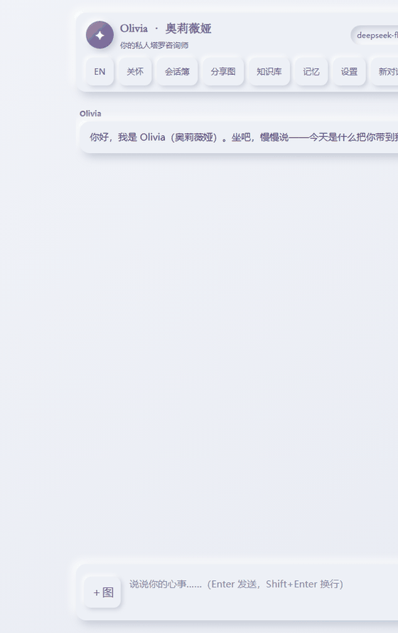

<div align="center">

# 🔮 Olivia

### A tarot reader who does not decide for you

Cards are drawn locally. Memories never leave this machine.  
She only begins reading after you say what you actually want to ask.

[](https://github.com/Him-Wang/tarot-counselor/actions/workflows/ci.yml)
[](CHANGELOG.md)
[](https://www.python.org/)
[](LICENSE)



<sub>[Home](docs/media/home.png) · [Spreads](docs/media/spreads.png) · [Cards](docs/media/cards.png) · [Reading](docs/media/reading.png) · [Settings](docs/media/settings.png) · [Mobile](docs/media/mobile.png)</sub>

<sub>[中文版](README.md)</sub>

</div>

---

## She is not an "AI fortune teller"

Olivia is made of three things, and none of them is optional:

1. **A real deck.** 78 public-domain 1909 RWS scans, 39 traditional spreads, drawn without replacement from the OS kernel entropy (CSPRNG) every time — unpredictable and non-reproducible.
2. **A real method.** Waite meanings, position meanings, card-to-card relations, reversal reading and court-card perspectives all live in checkable files — not in whatever the model improvises.
3. **An agent that holds back.** Nine tools — draw, look up, search, remember, take notes, remind — are chosen by the model. When to stop reading and offer help is decided by server code.

What she deliberately does not do:

- Predict specific events, dates, wins or deaths
- Give medical, legal or financial advice
- Role-play a medium or say "the cards tell me"
- Choose a job, a partner or a life direction for you
- Keep reading through self-harm, active abuse or sexual assault — **she stops**

That last point is not a polite request in a prompt. It is a gate at the `/api/chat` entrance: classify first, then decide whether to draw, call a model or write memory. A crisis request draws no cards, calls no tools, stores no transcript, and answers with emergency numbers, helpline resources and one sentence: "I cannot replace professional help."

> The cards do not speak; the person does. She stays with you through the reading, but she does not take over your life.

Full safety boundaries, AI disclosure and crisis resources: [SAFETY.md](SAFETY.md) (also available in-app at `/safety`).

---

## Start in thirty seconds

| Path | Command / action | Notes |
|---|---|---|
| **Windows** | Download `Olivia-setup.exe` from the [latest Release](https://github.com/Him-Wang/tarot-counselor/releases/latest) | Pick a folder, it starts the service and opens <http://127.0.0.1:8765>; Python 3 must be on PATH |
| **Source** | `cd agent && python server.py` | Python 3 standard library only, no dependencies |
| **Docker** | `docker compose up -d` | Data mounts at `./agent/data`; deleting the container does not erase her memory |
| **Phone** | `Olivia-release.apk` from the same Release | Thin WebView client that connects to port 8765 on your computer |

### Install from PyPI

```bash
pip install olivia-tarot
olivia            # start the local web service, then open http://127.0.0.1:8765
olivia-mcp        # or: start as an MCP stdio server (for Claude Desktop and friends)
```

Standard library only, zero runtime dependencies, Python 3.9+. Paste a model key in Settings on first launch.

Open Settings and paste a model key. Drawing, viewing and position meanings need no key; only "read this spread to me" calls a model.

### Which model

| Backend | How to fill it in |
|---|---|
| **DeepSeek** (default) | `https://api.deepseek.com/v1`; presets `deepseek-flash` / `deepseek-v4-pro` / `deepseek-chat` |
| **Anthropic** | Native Messages API, `sk-ant-…`, e.g. `claude-sonnet-4-5-20250929` |
| **Gemini** | Native GenerateContent API, e.g. `gemini-2.5-flash` |
| **Ollama** | `http://127.0.0.1:<port>/v1`, leave the key empty |
| **Others** | Protocol `auto` or `openai`; any OpenAI-compatible endpoint |

All three protocols share the same agentic loop and tool calls. The key is written only to `agent/config.json` (gitignored) and encrypted at rest.

---

## A reading has four beats

**One: draw.** You tap "draw" and she lists 39 spreads: one card, three cards, Celtic Cross, Tree of Life, seven chakras, relationship, either/or, yes/no, four seasons… Each position says on hover what it asks about. Once the spread is set, a fan of cards opens on the table: drag to browse, tap one and it flies into the next position; pick as many as the spread needs, in order. You can also let her draw at random. No replacement, reversals rotated 180°, laid out in traditional geometry. Fully local, zero API calls.

**Two: wait for your question.** Then she asks one thing: "What would you like to ask?" She will not guess from the cards before you speak. That is the point of the two-phase draw: cards first, question second.

**Three: read this spread.** The order is fixed: **traditional meaning → position → your question → your situation**. When two or more cards are read together, she also looks at elements, numerical stages, majors versus minors, court cards and narrative arc (`knowledge/meanings/牌间关系.md`). Perspectives, not formulas.

**Four: keep it.** Press "Stop" mid-reading and what was said stays; press "Add a card" for another angle, listed separately without replacing the original; render the cards and her words into a 1080-wide PNG; have it read aloud; see this turn's token count under each message. In Settings, enable "Daily card": every day she draws one locally into the inbox — no model call, works without a key. After a draw, click **Share link** to encode the spread into a `?reading=` deep link: recipients get a read-only preview that writes nothing to their memory and calls no model (see [docs/SHARE.md](docs/SHARE.md)).

---

## Why she is trustworthy

**The cards are not made up.** The 78 images are public-domain scans (`agent/cards/`, see `SOURCE.md`). There are two draw paths, and neither has a seed: in hand-pick mode the cards are the ones you chose yourself, placed in pick order, marked "manual"; in one-click random mode all cards are drawn from the OS kernel entropy (`random.SystemRandom()` / `os.urandom`). Upright/reversed orientation is generated fresh from kernel entropy at draw time. Every result is unpredictable and non-reproducible — there is no number that can replay a spread.

**Time is real.** Every turn injects the current date and time, so "tonight before bed" or "tomorrow at seven" rests on actual time, not years from training data.

**No key, no pretending.** When the model is unreachable, `agent/offline.py` composes the cards you already drew into text using position and traditional meaning, clearly labelled **【offline composition】not an AI reading**. She will not invent a reading to look useful.

**Memory has boundaries.** Crisis text never enters any memory table. Negations ("I will not kill myself") and dreams ("I dreamed someone was chasing me") are not misclassified as crises. Wrong memories can be deleted one by one or cleared in bulk.

**The method is inspectable.** Reading guides live in `knowledge/readings/`: flow, single-card depth, reversals, court cards. Meanings stay within the Waite system, with bibliographies at the top of each file; the writing is an original rewrite after looking at each card.

---

## What she can do

A real agentic loop: the model decides whom to call, and the UI shows each step with a ⚙ badge. Once the cards are drawn, the reading round locks the spread and only exposes the two read-only tools `lookup_card` / `search_knowledge` — the model can check references, but cannot redraw, swap cards or write memory.

| Tool | Purpose |
|---|---|
| `draw_cards` | Draw locally by spread, no replacement, OS-entropy random |
| `lookup_card` | Look up one card's upright / reversed Waite meaning |
| `search_knowledge` | Search method, card relations, empathic listening, ethics and referral |
| `save_memory` | Remember preferences, boundaries and explicit "please remember" |
| `recall_memory` | Recall profile, facts, draw history, or delete a wrong entry |
| `save_note` / `search_notes` | Archive and retrieve your notes |
| `crisis_check` | Crisis backstop (`safety.py` on the server is authoritative) |
| `schedule_reminder` | One-off / daily / weekly / every-N-minute reminders |

So she understands "remind me tomorrow at eight", "what did I ask last time", "what does Death mean" — not just card talk.

**Scheduling and watching** (`scheduler.py` / `watchers.py`, in the care panel): at the appointed time she writes a care note to the inbox and fires a Windows notification; quiet hours default to 22:00–08:00 and the master switch is off. Watching supports web / RSS / JSON / weather sources with contains, regex, numeric threshold, changed and new-item rules. The first run only establishes a baseline, so it does not cry wolf.

**Vision (optional):** give it any OpenAI-compatible VLM key and an image is first turned into an objective text description, then passed to the main model as context. The main model stays text-only and does not pretend to see.

---

## Memory and "forgetting"

`agent/memory.py` keeps four layers: **stable profile**, **facts** (preferences and boundaries), **conversations**, **draw history**, injected by relevance each turn.

Two more books: `agent/plugin_kb.py` is your note library (`kb.db`, archive, search, export Markdown); the session book lives in the browser, can be named and revisited, with deep links `#/chat/<id>` — crisis conversations keep only a placeholder, never the transcript.

All data lives in `agent/data/`: `memory.db`, `kb.db`, `scheduler.db`, `watchers.db`, `extras.jsonl`. Delete those files and she forgets; delete the install folder and it is gone.

Settings can export / import the whole thing as JSON: profile, facts, draws, conversations, notes, scheduled tasks and watchers, **without the key**. Databases use WAL and carry a schema version, migrating automatically on upgrade.

---

## There is only one case for networking

The default is `127.0.0.1`: only this machine, no pairing step.

Once `AGENT_HOST` is not a loopback address (for example, when your phone needs to connect), startup prints an 8-character pairing code, also stored in `agent/data/access_token`; `OLIVIA_TOKEN` lets you set your own. Another device enters it once, then an HttpOnly cookie remembers it; scripts may send an `X-Olivia-Token` header. Eight wrong codes from one IP within ten minutes are temporarily blocked.

Conversations, memories, notes and keys are never uploaded and never pass through a middle server. The API key is encrypted before it hits disk: DPAPI on Windows, a permission-hardened wrapper elsewhere. Plaintext keys in old configs migrate on the next save.

Want to share a public demo? Use the [read-only `OLIVIA_DEMO=1` demo mode](docs/DEMO.md) (saves nothing, offline replies, must sit behind an HTTPS reverse proxy).

---

## For other programs: MCP

`agent/mcp_server.py` is a zero-dependency MCP stdio server. It reads only the knowledge base and draws locally; it does not go online and does not touch your memory or key.

```json
{
  "mcpServers": {
    "olivia-tarot": {
      "command": "python",
      "args": ["C:/path/to/tarot-counselor/agent/mcp_server.py"]
    }
  }
}
```

| Tool | Returns |
|---|---|
| `draw_cards` | Positions, orientation, traditional meanings, layout coordinates |
| `lookup_card` | One card's Waite meaning (upright / reversed / both) |
| `search_knowledge` | Method, card relations, empathic listening, ethics and referral |
| `list_spreads` | Names and position notes of the 39 spreads |

Self-test: `python agent/mcp_server.py --selftest`.

### Streamable HTTP (remote / browser clients)

A zero-dependency HTTP transport sharing the same tools and permission boundary as stdio. Binds to loopback by default:

```bash
python agent/mcp_http.py
# Endpoint: http://127.0.0.1:8766/mcp ; health: http://127.0.0.1:8766/health
```

Override with `MCP_HTTP_HOST` / `MCP_HTTP_PORT` (binding `0.0.0.0` logs a warning — put it behind an authenticating proxy). POST `/mcp` answers in JSON or SSE (`Accept: text/event-stream`); GET/DELETE `/mcp` return 405. CORS preflight supported. Client config example:

```json
{"mcpServers": {"olivia-tarot": {"url": "http://127.0.0.1:8766/mcp"}}}
```

---

## Use her elsewhere

- **As a prompt**: drop `prompts/persona.zh.md` (optionally `tone.zh.md`) into ChatGPT custom instructions, a Claude Project or your own agent's system prompt
- **As a skill**: put the whole `skills/tarot-counselor/` folder into your skills directory (Claude Code `~/.claude/skills/`, DSH `~/.dsh/skills/`). She is an ordinary assistant most of the time and loads only when you ask for a reading or want to talk

---

## Verify it yourself

No third-party dependencies, no real model API, runs without a key:

```bash
python tests/test_whitebox.py     # 187 checks: source structure, pure functions, protocols, spreads, pairing/crypto/migrations/MCP/goals/archive/English KB
python tests/test_blackbox.py     # 75 checks: starts a real server on its own port and makes HTTP requests
python tests/test_safety_redteam.py  # 267 checks: safety-gate red-team cases (metaphors, negation, mixed zh-en); lists known gaps
python tests/test_mcp_http.py     # 27 checks: MCP Streamable HTTP (JSON / SSE / CORS / permission boundary)
python tests/test_backup_crypto.py   # 8 checks: encrypted backups (PBKDF2 + auth tag)
python tests/test_tls_server.py   # 7 checks: LAN self-signed HTTPS (incl. real TLS handshake)
python tests/test_demo_mode.py    # 48 checks: read-only demo (config hardening / write blocking / session reset)
python tests/test_share_link.py   # 22 checks: share deep links (encode/decode / corrupt & oversized tokens / read-only snapshot)
```

The black box covers: crisis requests draw no cards, call no tools and give resources first; draws use no replacement; without a key the reading turn is marked offline and does not pretend to be AI; crisis residue in history does not re-alert; card images are reachable and traversal is rejected; with `AGENT_HOST=0.0.0.0` unpaired requests get 401, wrong codes are throttled and the cookie works after pairing.

CI runs Python 3.9 / 3.12 on Ubuntu and Windows.

---

## Code map

```
agent/          HTTP server, three-protocol adapter, tools, spreads, knowledge retrieval, memory, scheduling, pairing
knowledge/      Meanings, card relations, reading guides, spread reference, ethics and referral
prompts/        Persona, tone, prophecy mode (Chinese and English)
skills/         Lazily loaded skill form
android/        Thin WebView client and a Gradle-free build script
installer/      Windows single-file installer
tests/          White-box and black-box self-checks
docs/           Architecture, self-hosting, screenshots and demo
```

Key entry points: [`agent/server.py`](agent/server.py) (orchestration and the safety gate), [`agent/safety.py`](agent/safety.py) (crisis classification), [`agent/spreads.py`](agent/spreads.py) (single source of truth for 39 spreads), [`knowledge/INDEX.md`](knowledge/INDEX.md) (material entry point).

The mobile client implements no logic of its own: meanings, memory and schedules exist once on the computer, and the phone is just a window. Building it needs no Android Studio or Gradle:

```powershell
powershell -NoProfile -ExecutionPolicy Bypass -File android\build.ps1
# artifact: android\build\Olivia-release.apk
```

---

## License

"Play with it however you like, just do not make money from it":

| Content | License |
|---|---|
| Program code (`agent/` `android/` `installer/` `tests/`) | [PolyForm Noncommercial 1.0.0](LICENSE) |
| Persona, tone, meanings, spreads, reading guides (`prompts/` `skills/` `knowledge/`) | [CC BY-NC-SA 4.0](LICENSE-CONTENT) |
| 78 card images (1909 RWS) | Public domain; see `agent/cards/SOURCE.md` |

You may use it yourself, tinker, show friends and share non-commercially (with `LICENSE` and the `Required Notice` attribution). You may not sell it, include it in a paid product or service, use it as a production tool at work, or repackage and publish it under another name.

**Commercial use?** See [`COMMERCIAL.md`](COMMERCIAL.md). Individuals, study, research and non-profit use need no contact.

The "Olivia / 奥莉薇娅" name and persona belong to the author.
