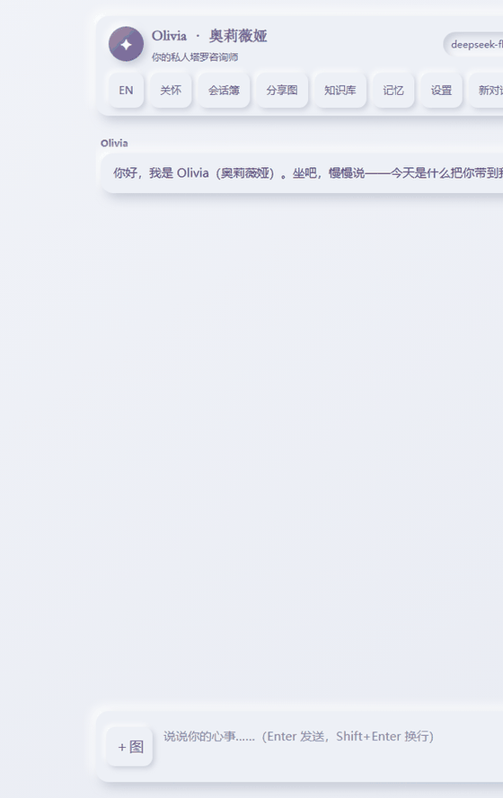

<div align="center">

# 🔮 Olivia

### 一个不替你决定的塔罗师

牌在本地抽，记忆不出这台机器。  
她只在你把问题说出口之后，才开始读。

[](https://github.com/Him-Wang/tarot-counselor/actions/workflows/ci.yml)
[](CHANGELOG.md)
[](https://www.python.org/)
[](LICENSE)



<sub>[首页](docs/media/home.png) · [牌阵](docs/media/spreads.png) · [牌面](docs/media/cards.png) · [解读](docs/media/reading.png) · [设置](docs/media/settings.png) · [手机端](docs/media/mobile.png)</sub>

<sub>[English](README.en.md)</sub>

</div>

---

## 她不是「AI 算命」

Olivia 由三样东西组成，缺一样都不成立：

1. **一副真的牌。** 78 张 1909 年韦特（RWS）扫描，39 种传统牌阵，不放回随机，每次给出复现种子。
2. **一套真的方法。** 韦特牌义、牌位含义、牌间关系、逆位读法、宫廷牌视角，全部是可查的文件，不是模型临场编的解释。
3. **一个会克制的 agent。** 抽牌、查牌、检索、记忆、笔记、提醒，9 个工具由模型判断何时调用；什么时候该停下来给求助资源，由服务端代码判断。

她明确不做这些事：

- 不预测具体事件、日期、输赢、生死
- 不看医疗、法律、财务问题
- 不扮演通灵者，不说「牌告诉我」
- 不替你选工作、伴侣或人生方向
- 遇到自伤、正在受暴力、性侵害，**停止占卜**

最后一条不是提示词里的请求，是 `/api/chat` 入口处的一段闸门：先分类，再决定要不要抽牌、调模型、写记忆。危机请求不会发牌、不会调工具、不会把原文存进数据库，回应里只有 110 / 120、心理援助热线和一句「我不能替代专业帮助」。

> 牌不开口，人开口。她陪你把牌读完，但不接管你的人生。

完整的安全边界、AI 披露与危机资源见 [SAFETY.md](SAFETY.md)（应用内可打开 `/safety`）。

---

## 三十秒开始

| 方式 | 命令 / 动作 | 说明 |
|---|---|---|
| **Windows** | 从 [最新 Release](https://github.com/Him-Wang/tarot-counselor/releases/latest) 下载 `Olivia-setup.exe` | 选目录、起服务、打开 <http://127.0.0.1:8765>；本机需有 Python 3 且在 PATH |
| **源码** | `cd agent && python server.py` | 只用 Python 3 标准库，不装任何依赖 |
| **Docker** | `docker compose up -d` | 数据挂在 `./agent/data`，删容器不失忆 |
| **手机** | 同一个 Release 里的 `Olivia-release.apk` | WebView 薄客户端，连电脑上的 8765 端口 |

### 从 PyPI 安装

```bash
pip install olivia-tarot
olivia            # 启动本地网页服务，打开 http://127.0.0.1:8765
olivia-mcp        # 或：以 MCP stdio 方式启动（供 Claude Desktop 等客户端接）
```

纯标准库、零运行时依赖，支持 Python 3.9+。首次打开后在「设置」里填模型 key。

第一次打开后点「设置」，填一个模型 key。抽牌、看牌、读牌位都不需要 key；只有「把牌读给你听」会调用模型。

### 接哪个模型

| 后端 | 填法 |
|---|---|
| **DeepSeek**（默认） | `https://api.deepseek.com/v1`，预设 `deepseek-flash` / `deepseek-v4-pro` / `deepseek-chat` |
| **Anthropic** | 原生 Messages API，`sk-ant-…`，模型如 `claude-sonnet-4-5-20250929` |
| **Gemini** | 原生 GenerateContent API，模型如 `gemini-2.5-flash` |
| **Ollama** | `http://127.0.0.1:<端口>/v1`，key 留空 |
| **其它** | 协议选 `auto` 或 `openai`，任何 OpenAI 兼容端点 |

三种协议共用同一套 agentic loop 与工具调用。key 只写进 `agent/config.json`（已 gitignore），落盘前加密。

---

## 一次占卜，只有四个节拍

**一、抽牌。** 你点「抽牌」，她列出 39 个牌阵：单张、三张、凯尔特十字、生命之树、七脉轮、关系、二选一、是非、四季……每个牌位上悬浮写着「这个位置在问什么」。牌阵定下后，桌上铺开一副扇形牌堆：牌背朝上，展示顺序每次都用 `crypto.getRandomValues` 重新洗牌；拖动翻看，轻点一张，牌就飞进下一个牌位；挑满张数按挑选顺序落位。想省事就点「🎲 一键真随机」——由操作系统内核熵（`os.urandom`）抽牌，每次都不同、不可复现。牌不放回，逆位转 180°，按传统几何摆开。全程本地，零 API 调用。

**二、等你开口。** 摆完她只问一句：「你有什么问题吗？」在你把问题说出口之前，她不会用牌去猜。这是两阶段抽牌的意义——先有牌，后有问。

**三、读这副牌。** 落点固定为 **原本牌意 → 牌阵位置 → 你的问题 → 你的情境**。两张以上连读时，再从元素、数字阶段、大小牌对位、宫廷牌、叙事弧线五个角度看牌与牌的关系（`knowledge/meanings/牌间关系.md`）。这些是视角，不是套公式。

**四、留下来。** 读到一半可以按「停止」，说过的话保留；想补一个视角就按「补一张」，新牌单列、不替换原牌；可以把牌面和她的话存成一张 1080 宽的 PNG；可以让她朗读；每条消息下面记着本轮 tokens。设置里还能开「每日一牌」——到点本地抽一张写进收件箱，不调模型，没 key 也照常送达。抽完牌还能点「分享链接」，把牌阵编进一条 `?reading=` 深链，别人打开只是只读预览，不写他的记忆也不调模型（见 [docs/SHARE.md](docs/SHARE.md)）。

---

## 她凭什么可信

**牌不是现编的。** 78 张牌面是公有领域扫描（`agent/cards/`，来源见 `SOURCE.md`）。两条抽牌路径互不干扰：

- **手选**：牌面由你亲手挑出，按挑选顺序落位，界面标「手选」。正逆位由一颗种子决定，同种子 + 同几张牌可复现同一组正逆位，供你审计；种子由系统熵（`os.urandom`）生成，走 HMAC-SHA256 比特流（CSPRNG），不是可反推的 MT19937。界面默认隐藏这颗种子，想核对可看牌面详情。
- **一键真随机**：走独立的 `random.SystemRandom()` 路径，每次从内核重新取熵，牌面不可预测、不可复现、不产生种子——它不会有「同种子同牌」这种看起来像预设的行为。这也是每日一牌与 MCP `draw_cards` 的取值方式。

**时间是真的。** 每轮都把当前日期与时刻注入上下文，所以「今晚睡前」「明早七点」有真实时间可依，不会拿训练数据里的年份瞎猜。

**没 key 不装。** 模型连不上或没填 key 时，`agent/offline.py` 把你已经抽好的那副牌按「牌位 + 传统牌意 + 复现种子」整理成文字，并明确标【离线整理】不是 AI 解读。她不会为了显得有用而编一段话。

**记忆有边界。** 危机文本不进任何记忆表；「我不会自杀」这类否定句、梦到追杀这类梦境，不会被误判成危机。记错的东西可以删，也可以清空最近几条。

**方法可查。** 解牌方法在 `knowledge/readings/`：读牌流程、单张深读、逆位读法、宫廷牌读法。牌义只做韦特体系，参考书目列在各文件头部；写法是读图后的原创重写。

---

## 她能做的事

真 agentic loop，模型自己决定调谁，界面用 ⚙ 显示每一步。抽牌完成后进入解读轮，牌面与牌阵已经锁定，这一轮只放开 `lookup_card` / `search_knowledge` 两个只读工具——模型可以补查资料，但改不了牌，也写不了记忆。

| 工具 | 用途 |
|---|---|
| `draw_cards` | 按牌阵本地抽牌，不放回、带种子 |
| `lookup_card` | 直查一张牌的正 / 逆位传统牌意 |
| `search_knowledge` | 检索解牌方法、牌间关系、共情式倾听、伦理与转介 |
| `save_memory` | 记住你明确说过的偏好、边界、「请记住」 |
| `recall_memory` | 回想画像、线索、抽牌历史，或删掉记错的一条 |
| `save_note` / `search_notes` | 把笔记归档、翻出来 |
| `crisis_check` | 危机兜底（服务端 `safety.py` 是权威闸门） |
| `schedule_reminder` | 一次 / 每天 / 每周 / 间隔 N 分钟的提醒 |

所以她听得懂「明晚八点提醒我」「我上次问过什么」「死神这张牌什么意思」，而不只是聊牌。

**定时与盯事**（`scheduler.py` / `watchers.py`，在「关怀」面板）：到点写关怀进收件箱并弹 Windows 通知；安静时段默认 22:00–08:00，总开关默认关闭。盯事支持网页 / RSS / JSON / 天气，规则有 contains、regex、数值阈值、变了、有新条目；首次只建基线，不会一上来就误报。

**目标—状态—下一步**（`goals.py`）：关怀面板里可以记下你正在推进的目标（进行中 / 暂停 / 已完成 / 已放下）和下一步。下一步分「你自己定的」和「Olivia 提的建议」——建议只有你点头才算数。定时任务和盯事可以关联到目标，到点/命中时的主动汇报会带上关联目标。Olivia 只会在对话与关怀里温和回访这些目标，**不替你决定、不擅自推进状态**；「确认做到」「改状态」只能你在界面上做。

**占卜档案**（`archive.py`）：每次解读完成后 Olivia 会问一句「现在的心情」——你点选情绪 chip 或自己打一个词，答复后才追加一条 JSON（时间、问题、牌阵、解读要点、情绪标签、牌面）；没答就暂不记。可在关怀面板按用户 / 主题 / 关键词回看。情绪标签只记你亲口说过的词，不猜测、不代选；危机内容不入库。档案只存本机 `agent/data/archive/`。

**视觉（可选）**：填一个 OpenAI 兼容 VLM 的 key，图片先被转成客观文字描述，再作为线索交给主模型。主模型始终是纯文本，不假装自己看见了。

---

## 记忆与「忘记」

`agent/memory.py` 分四层：**稳定画像**、**线索**（偏好与边界）、**对话**、**抽牌历史**。每轮按相关度注入，不用你重复自己。

另外两本：`agent/plugin_kb.py` 是个人笔记库（`kb.db`，可归档、检索、导出 Markdown）；会话簿存在浏览器本地，可命名、回访，深链 `#/chat/<id>`，危机对话只存占位、不存原文。

数据全在 `agent/data/`：`memory.db`、`kb.db`、`scheduler.db`、`watchers.db`、`extras.jsonl`。删掉这些文件等于让她失忆，删掉安装目录就是彻底清除。

设置里可以整体导出 / 导入一个 JSON：画像、线索、抽牌、对话、笔记、定时任务、盯事都在里面，**不含 key**。数据库用 WAL 并带 schema 版本号，升级时自动迁移。

---

## 联网只有一种情况

默认 `127.0.0.1`，只有本机能访问，没有配对步骤。

一旦把 `AGENT_HOST` 设成非回环地址（比如手机要连），启动时控制台会打印一个 8 位配对码，也存在 `agent/data/access_token`；`OLIVIA_TOKEN` 可以指定自己的。别的设备第一次打开要输入这串码，之后靠 HttpOnly Cookie 记住；脚本可以带 `X-Olivia-Token` 头。同一 IP 十分钟内错 8 次会被暂时挡住。

对话、记忆、笔记、key 都不上传、不过中间服务器。API key 落盘前加密：Windows 走 DPAPI，其它平台退化为收紧权限的包装。旧配置里的明文 key 会在下一次保存时自动迁移。

要放到公网上给别人体验？用 [`OLIVIA_DEMO=1` 只读演示模式](docs/DEMO.md)（不保存任何数据、离线回复，须置于 HTTPS 反向代理之后）。

---

## 给别的程序用：MCP

`agent/mcp_server.py` 是一个零依赖的 MCP stdio server，默认只读知识库并本地抽牌，不联网、不碰你的记忆与 key。

有限写入是**显式 opt-in**：设置环境变量 `OLIVIA_MCP_WRITES=1` 才开放，白名单只有 `save_memory` / `schedule_reminder` / `goal_add` / `goal_suggest_step` / `archive_append`——都是「新增 / 提建议」，**没有**删除、清空、确认、推进状态工具。也就是说另一个 AI 客户端无权替你拍板，这守住 Olivia「不替你决定」的底线。不设环境变量时行为和以前完全一样（只读）。

```json
{
  "mcpServers": {
    "olivia-tarot": {
      "command": "python",
      "args": ["C:/path/to/tarot-counselor/agent/mcp_server.py"]
    }
  }
}
```

| 工具 | 返回 |
|---|---|
| `draw_cards` | 牌位、正逆位、传统牌意、布局坐标、复现种子 |
| `lookup_card` | 单张韦特牌意（正位 / 逆位 / 两者） |
| `search_knowledge` | 解牌方法、牌间关系、共情式倾听、伦理与转介 |
| `list_spreads` | 39 个牌阵的名称与位置说明 |
| `list_goals`（只读） | 目标、状态与下一步（区分自己定的 / 待确认的建议） |
| `search_archive`（只读） | 按用户 / 主题 / 关键词检索占卜档案 |

开启 `OLIVIA_MCP_WRITES=1` 后追加：`save_memory`、`schedule_reminder`、`goal_add`、`goal_suggest_step`（建议强制标记 suggested）、`archive_append`。

自检：`python agent/mcp_server.py --selftest`。

### Streamable HTTP（远程客户端 / 浏览器）

零依赖的 HTTP 传输，和 stdio 版共用同一套工具与权限边界。默认只绑定回环地址：

```bash
python agent/mcp_http.py
# 端点：http://127.0.0.1:8766/mcp ；健康检查：http://127.0.0.1:8766/health
```

可用 `MCP_HTTP_HOST` / `MCP_HTTP_PORT` 改地址端口（绑 `0.0.0.0` 会打印警告，请放在有认证的代理后）。POST `/mcp` 支持 JSON 或 SSE（`Accept: text/event-stream`）响应，GET/DELETE `/mcp` 返回 405。支持 CORS 预检。客户端配置示例：

```json
{"mcpServers": {"olivia-tarot": {"url": "http://127.0.0.1:8766/mcp"}}}
```

---

## 换个地方用她

- **当提示词**：`prompts/persona.zh.md`（可加 `tone.zh.md`）放进 ChatGPT 自定义指令、Claude Project 或自建 Agent 的 system prompt
- **当技能**：整个 `skills/tarot-counselor/` 放进技能目录（Claude Code `~/.claude/skills/`、DSH `~/.dsh/skills/`），平时是普通助手，求占或想说话时才加载

---

## 自己验

零第三方依赖，不碰真实模型 API，没 key 也能跑：

```bash
python tests/test_whitebox.py     # 187 项：源码结构、纯函数、协议转换、牌阵、配对/加密/迁移/MCP/目标/档案/英文知识库
python tests/test_blackbox.py     # 75 项：独立端口起真实服务，发 HTTP 请求
python tests/test_safety_redteam.py  # 267 项：安全闸门红队对抗用例（隐喻/否定/中英混写），并列出已知缺口
python tests/test_mcp_http.py     # 27 项：MCP Streamable HTTP（JSON / SSE / CORS / 权限边界）
python tests/test_backup_crypto.py   # 8 项：加密备份（PBKDF2 + 认证标签）
python tests/test_tls_server.py   # 7 项：局域网自签 HTTPS（含真实 TLS 握手）
python tests/test_demo_mode.py    # 48 项：只读演示模式（配置夹取 / 阻断写入 / 会话重置）
python tests/test_share_link.py   # 22 项：分享深链（编解码 / 损坏与超大 token 拒绝 / 只读快照）
```

黑盒覆盖：危机请求不发牌 / 不调工具 / 先给资源；抽牌不放回；无 key 时解读轮标 offline 且不伪装 AI；历史里的危机残留不二次报警；牌图可访问、目录穿越被拒；`AGENT_HOST=0.0.0.0` 时未配对 401、错码限流、对码后 Cookie 放行。

CI 在 Ubuntu 与 Windows 上跑 Python 3.9 / 3.12 四个组合。

---

## 代码地图

```
agent/          HTTP 服务、三协议适配、工具、牌阵、牌义检索、记忆、定时、配对
knowledge/      牌义、牌间关系、解牌方法、牌阵速查、伦理与转介
prompts/        人格、语气、预言模式（中英）
skills/         按需加载的 skill 形态
android/        WebView 薄客户端与免 Gradle 构建脚本
installer/      Windows 单文件安装器
tests/          白盒 + 黑盒自查
docs/           架构、自托管、截图与演示
```

关键入口：[`agent/server.py`](agent/server.py)（编排与安全闸门）、[`agent/safety.py`](agent/safety.py)（危机分类）、[`agent/spreads.py`](agent/spreads.py)（39 个牌阵的唯一来源）、[`knowledge/INDEX.md`](knowledge/INDEX.md)（资料入口）。

手机端不重新实现任何逻辑：牌义、记忆、定时任务只有电脑上这一份，手机只是窗口。自己出包不需要 Android Studio 或 Gradle：

```powershell
powershell -NoProfile -ExecutionPolicy Bypass -File android\build.ps1
# 产物 android\build\Olivia-release.apk
```

---

## 许可

「随便玩，但别拿去赚钱」：

| 内容 | 许可 |
|---|---|
| 程序代码（`agent/` `android/` `installer/` `tests/`） | [PolyForm Noncommercial 1.0.0](LICENSE) |
| 人格、语气、牌义、牌阵、解牌方法（`prompts/` `skills/` `knowledge/`） | [CC BY-NC-SA 4.0](LICENSE-CONTENT) |
| 78 张牌面（1909 RWS） | 公有领域，出处见 `agent/cards/SOURCE.md` |

可以自用、改着玩、给朋友看、非商业分享（带上 `LICENSE` 与 `Required Notice` 署名）。不可以卖、作为付费产品或服务的一部分、在公司里当生产工具，或换名包装再发布。

**想商用？** 见 [`COMMERCIAL.md`](COMMERCIAL.md)。个人、学习、研究、非营利用途不用联系。

「Olivia / 奥莉薇娅」的名字与人格设定归作者所有。
