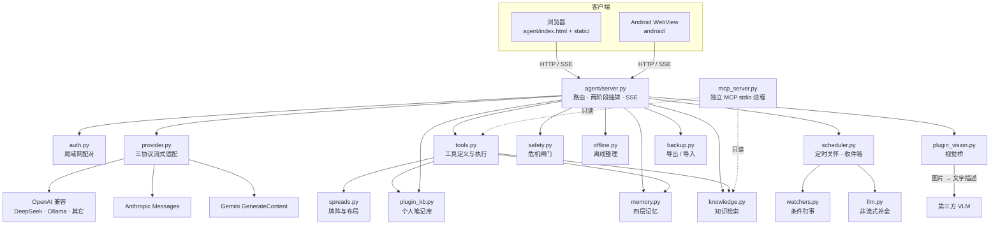
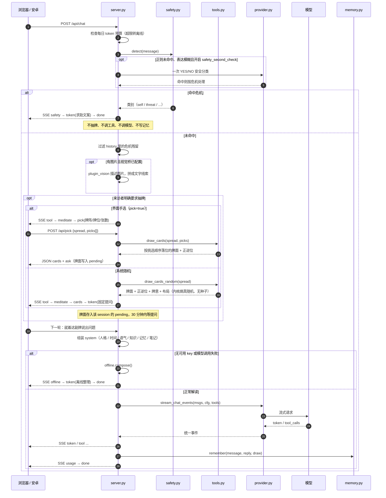

# 架构说明

Olivia 是一个单进程、纯标准库的本地 HTTP 服务。浏览器与安卓 WebView 只是窗口：牌、记忆、笔记、定时任务与安全闸门都在 `agent/` 里，只有“解读”这一步会把上下文发给模型。

## 总览

`mcp_server.py` 不在 HTTP 服务进程里，是给 Claude Desktop、Cursor 等客户端单独启动的 stdio 旁路；它只读知识库并本地抽牌，不读写用户记忆与配置。界面壳在 `agent/index.html`，样式、脚本与 PWA 资源在 `agent/static/`（`app.css`、`app.js`、`i18n.js`、`manifest.webmanifest`、`sw.js`）。

## 模块职责

| 文件 | 一句话职责 |
|---|---|
| `agent/server.py` | HTTP 路由、静态页面与牌图、两阶段抽牌、SSE 流、安全闸门入口与配置读写。 |
| `agent/auth.py` | 局域网模式的配对码生成、校验、Cookie 下发与失败限流。 |
| `agent/backup.py` | 把记忆、笔记、定时任务、盯事与补牌记录导出为 JSON，并以合并方式导入。 |
| `agent/db.py` | 统一的 SQLite 连接入口与基于 `PRAGMA user_version` 的 schema 迁移。 |
| `agent/provider.py` | 把 OpenAI 兼容、Anthropic Messages、Gemini GenerateContent 三种流式协议翻译成统一的 token / tool_calls / done 事件。 |
| `agent/llm.py` | 面向定时关怀等非交互场景的简单 OpenAI 兼容流式与非流式补全客户端。 |
| `agent/tools.py` | 定义 9 个工具的 JSON Schema、执行函数与给界面看的摘要行。 |
| `agent/spreads.py` | 39 个牌阵的唯一来源：牌位、含义、分类、几何布局与目录输出。 |
| `agent/safety.py` | 中英文危机类别判定、可选的语言学二次检查与安全回应文案，不碰网络或数据库。 |
| `agent/offline.py` | 无可用模型时，按已抽牌面、牌位与传统牌意生成明确的离线整理。 |
| `agent/memory.py` | 用规则抽取维护画像、线索、对话、抽牌历史与每日 token 用量，并按相关度注入上下文。 |
| `agent/knowledge.py` | 对 `knowledge/` 做中文二元组关键词检索，并提供按牌名直查牌义。 |
| `agent/scheduler.py` | 后台线程检查定时任务与盯事，生成关怀消息写入收件箱，并触发 Windows 通知。 |
| `agent/watchers.py` | 抓取网页 / RSS / JSON / 天气数据源，按 contains、regex、阈值、变化等规则判断是否提醒。 |
| `agent/plugin_kb.py` | 用户主动归档的个人笔记库，支持增删改查、置顶、检索与 Markdown 导出。 |
| `agent/plugin_vision.py` | 可选的视觉桥：把图片发给用户配置的第三方 VLM，换回客观文字描述。 |
| `agent/secret_store.py` | 保存密钥前加密：Windows 用 DPAPI，其他平台退化为 base64 包装并收紧文件权限。 |
| `agent/mcp_server.py` | 独立的 MCP stdio 服务，把抽牌、查牌、检索与牌阵清单只读地暴露给外部客户端。 |

## 一次 `/api/chat` 的时序

请求体：`{ message, history, images, session_id, api_key? }`。响应是 `text/event-stream`，一行一个 `data: {...}`。局域网模式下，除 `/api/pair` 外的 `/api/*` 先校验配对 Cookie 或 `X-Olivia-Token`；静态页面与牌图不校验。

要点：

1. **安全闸门在最前。** `safety.detect()` 在视觉桥、抽牌、主模型与记忆之前执行；命中即切断，历史中的危机残留也会被过滤。可选的 `safety_second_check` 默认关闭；开启后只会把正则未命中但表达模糊的那一句先发给模型做一次 YES/NO 分类，再决定是否切断。
2. **两阶段抽牌。** 抽牌轮完全本地，不调用模型。牌面按 `session_id` 暂存在内存，等下一轮问题到来才解读。两条路径的正逆位都由 `random.SystemRandom()`（底层 `os.urandom`）即时产生，不可预测、不可复现、没有任何可重放的数字：
   - **手选**（界面默认）：牌阵定下后 `/api/chat` 只发 `pick` 舞台（不发牌），来访者挑满张数后 `POST /api/pick` 把下标按顺序交给 `draw_cards(picks=…)`，只随机正逆位，并按同一套 pending 流程进入解读轮。
   - **一键真随机**：`POST /api/random-draw` 或 `/api/chat` 不带 `pick` 时调用 `draw_cards_random()`，从 78 张里不放回随机抽取；每日一牌与 MCP `draw_cards` 也走这条路径。
3. **解读轮是硬约束。** 已抽出的牌面、牌位含义与传统牌意被写进 system；这一轮只给模型 `lookup_card` / `search_knowledge` 两个只读工具，`draw_cards` 与记忆写入工具都不下发，模型不能重抽、换牌或自行补牌。
4. **补牌是显式路径。** 只有识别到来访者主动“补一张”才调用 `tools.extra_card()`，理由写入 `extras.jsonl`，原牌不替换。
5. **agentic loop。** 普通对话最多 6 轮“模型 → 工具 → 模型”；解读轮另有只读工具循环，最多 3 轮，轮数用尽后再补一次纯文本收尾。每次工具调用先执行 `tools.execute()`，再把结果作为 `role=tool` 消息送回模型。
6. **离线兜底。** 没有可用 key、模型连接失败或当日 token 预算用尽时，不伪装成 AI 解读，只按本地牌面与传统牌意整理，并发出 `offline` 标记。
7. **预算守卫。** 设置了 `daily_token_budget` 后，当日累计用量达到上限就自动转离线；本地抽牌、看牌与读牌位不受影响。
8. **历史裁剪。** 发给模型的历史受 `max_history_messages` 与 `max_history_chars` 限制，既控制成本，也避免把过长的旧上下文重新带出本机。

### SSE 事件类型

| 事件键 | 含义 |
|---|---|
| `token` | 增量文本，前端按打字机效果追加。 |
| `tool` | 一次工具调用的可读摘要，前端显示 ⚙ 徽章。 |
| `cards` | 结构化牌面：牌阵、布局、每张牌的名、正逆位、位置、图片、补牌。 |
| `meditate` | 抽牌前的仪式引导语，前端先打字、停顿，再翻牌。 |
| `pick` | 手选舞台：`{spread, spread_desc, count, positions[]}`，前端摆出扇形牌堆与牌位。 |
| `usage` | 本轮累计 tokens：`{in, out, total}`，为 0 时不发。 |
| `done` | 本轮结束标记。 |
| `budget` | 当日预算：`{limit, used, exceeded}`，只在配置了 `daily_token_budget` 时发。 |
| `meta` | 本轮自动检索到的知识文档列表。 |
| `safety` | 命中危机闸门时的类别，如 `self`、`threat`、`sexual-assault`。 |
| `offline` | 进入离线整理或模型失败降级。 |
| `spread_choices` | 只说“抽牌”时返回的牌阵按钮清单。 |

## 数据落盘位置

所有运行数据都在 `agent/data/`（首次访问时自动创建），配置在 `agent/config.json`。

| 路径 | 内容 | 隐私边界 |
|---|---|---|
| `agent/config.json` | 后端、协议、`base_url`、`api_key_enc`（加密后的密钥）、模型、温度、超时、预算、语言与各功能开关。 | 已被 `.gitignore`；接口返回时 key 打码；安装器打包时排除。Windows 用 DPAPI 加密，其他平台为 base64 包装 + `0600` 权限（掩盖而非强加密）；旧明文会在下次保存时迁移。 |
| `agent/data/memory.db` | `profile` 稳定画像、`facts` 线索、`messages` 对话、`draws` 抽牌历史、`usage` 每日 token 用量。 | 最敏感的个人数据；危机内容不提升为长期线索；永不上传整库。 |
| `agent/data/kb.db` | 用户主动归档的笔记：标题、正文、标签、置顶、来源。 | 个人资料；可导出 Markdown；删库即清空。 |
| `agent/data/scheduler.db` | 定时任务、事件、收件箱消息与关怀总开关 / 安静时段。 | 含用户写的关怀意图与生成的消息；只在本机。 |
| `agent/data/watchers.db` | 盯事定义、上次观测值、冷却时间与触发记录。 | 含用户填写的 URL、字段路径与观测到的外部内容。 |
| `agent/data/extras.jsonl` | 每次补牌的牌面与来访者写下的理由。 | 追加写入；含个人语境，随 `data/` 一起删除或备份。 |
| `agent/data/plugins.json` | 视觉桥开关、`base_url`、模型与第三方 VLM 的 key。 | 已被 `.gitignore`；接口返回时 key 打码；该 key 仍以明文保存，需依赖文件权限。 |
| `agent/data/access_token` | 局域网配对码（未设置 `OLIVIA_TOKEN` 时生成的 8 位十六进制码）。 | 等同访问凭证；备份文件也应按密钥保管。 |
| `agent/olivia.pid` | 当前服务进程号，供安装器卸载时精确停止。 | 运行时文件，无个人数据。 |
| 浏览器 `localStorage` | 会话簿、深链与界面偏好。 | 留在浏览器，不在 `agent/data/`；清除站点数据即删除。 |
| 安卓 WebView 存储 / 相册 | 会话簿、上次地址、下载的分享图。 | 留在手机；卸载 App 或清数据、删相册才彻底清除。 |

**隐私边界**：服务不向本项目自己的服务器发送任何数据，也没有遥测。会离开本机的只有三类请求：发给用户所选模型服务商的对话上下文；启用视觉桥时发给第三方 VLM 的图片；条件盯事访问用户配置的数据源与 Open-Meteo 天气接口。其余检索、抽牌、记忆、定时与安全判定都在本机完成。

**导出与鉴权**：界面里的「导出全部数据」走 `GET /api/backup`，导出画像、线索、抽牌历史、笔记、定时任务、盯事与补牌记录，**不包含原始对话消息与 API key**；`POST /api/backup` 是合并导入，不会清空现有数据。局域网模式下 `auth.py` 会在启动时启用，`/api/*` 需要配对码；静态页面与牌图不要求鉴权。

## 如何新增一个工具

工具是“模型可以决定是否调用”的能力，新增时保持 `tools.py` 单点定义：

1. 在 `agent/tools.py` 的 `TOOLS` 列表里加一段 OpenAI function-calling Schema：`name`、`description`、`parameters`。
2. 写一个普通函数，接收参数并返回可 JSON 序列化的 dict；失败时返回 `{"ok": False, "reason": ...}`，不要抛异常给模型。
3. 在 `EXECUTORS` 字典里把工具名映射到执行函数，参数从 `args` 里取默认值。
4. 在 `TOOL_GUIDE` 里补一行“什么时候该调用”，否则模型不知道使用边界。
5. 在 `summary()` 里加一个分支，给界面生成短徽章文案；不加也能跑，但会落到通用文案。
6. 补测试：白盒至少验证函数纯逻辑；涉及 HTTP 行为时在黑盒里发真实请求。`server.py` 的 agentic loop 会自动执行新工具，不需要改路由。

注意：抽牌、补牌这类会破坏“客观随机”的工具不要只靠模型自觉。抽牌由服务端编排，补牌只走显式按钮路径，`draw_cards` 在解读轮压根不下发给模型（只给 `READ_TOOLS` 里的只读工具）。新增工具时想让它进入解读轮，必须显式加进 `tools.READ_TOOL_NAMES`，并且不能有副作用。

如果还想把同一个能力暴露给 MCP 客户端，需要在 `agent/mcp_server.py` 的 `TOOLS` 与 `call_tool()` 里另外注册；它只读知识库与抽牌，不共享 `tools.EXECUTORS`，也不读写用户记忆和配置。

## 如何新增一个牌阵

牌阵的唯一来源是 `agent/spreads.py`：

1. 在 `SPREAD_DEFS` 末尾追加一个 dict：`name`（唯一中文名）、`category`、`desc`、`positions`。`positions` 是 `(牌位名, 这个位置在问什么)` 的列表，顺序就是抽牌与阅读顺序。
2. 在 `LAYOUTS` 里为同名牌阵加几何布局：`cols`、`rows`、`cells`。`cells` 的数量必须等于 `positions` 的数量，坐标从 `(1, 1)` 开始；第三项写 `90` 表示横放（凯尔特十字的阻碍牌）。
3. 不写 `LAYOUTS` 也能运行：`layout()` 会退化成一行排开，但传统牌阵建议按传统几何摆。
4. 检查同一牌阵内格坐标不重叠；`tests/test_whitebox.py` 会验证“格数 = 牌位数”和“无意外重叠”，并要求总数不少于 39。
5. 跑 `python tests/test_whitebox.py`。前端从 `/api/config` 的 `spreads` 自动取清单与布局，提示词从 `spreads.catalogue()` 自动取目录，不需要再改别处。
6. 如果牌阵有专门的解牌说明，可同步补到 `knowledge/spreads/牌阵速查.md`；那属于内容层，不参与代码逻辑。
